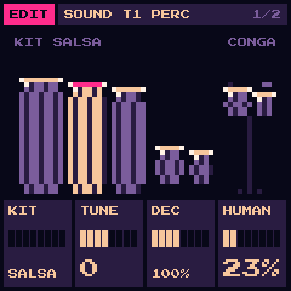

# COQUÍ manual

Version 0.1 · for the M-VAVE FM-1

COQUÍ is built on [GR!MM](https://github.com/GRiMMBIENT/grimm) 2.0.2. This manual covers what COQUÍ adds and changes.
Everything else (the four tracks, HOME and the mixer, SEQ, ARP, SEL's scales and chords, GLO's song mode, FX and
PERFORM, GENERATE, SYSTEM, SAVE) works as
[GR!MM 2.0's manual](https://github.com/GRiMMBIENT/grimm/blob/v2.0/MANUAL.md) describes it, apart from the VOICE source
and its choirs, which COQUÍ does not have.

## 1. PERC: the percussion source

A track plays PERC when its source is PERC: **EDIT**, then **EDIT** again for SOURCE, **KNOB 1** to PERC. Or turn
**PRESETS** to one of the PERC kits (category PERC).

On a PERC track every key is a drum, not a note:

| White keys | F3 | G3 | A3 | B3 | C4 | D4 | E4 | F4 | G4 | A4 | B4 | C5 | D5 | E5 | F5 | G5 |
|---|---|---|---|---|---|---|---|---|---|---|---|---|---|---|---|---|
| | KICK | SNARE | CLAP | CASCARA | COWBELL | CLAVE | GUIRO | TUMBA | CONGA | QUINTO | BONGO LO | BONGO HI | TIMBAL LO | TIMBAL HI | BOOM | TAMBORA |

| Black keys | F#3 | G#3 | A#3 | C#4 | D#4 | F#4 | G#4 | A#4 | C#5 | D#5 | F#5 |
|---|---|---|---|---|---|---|---|---|---|---|---|
| | HAT | OPEN HAT | MARACAS | BELL | WOOD | SLAP | MUTE | GUIRO LONG | BONGO SLAP | PAILA | RIM |

- The lower half is the kit and the salsa section (cowbell, clave, güiro); the upper half the hand drums.
- The conga has three strokes: **G4** open, **G#4** mute, **F#4** slap. Each one cuts the one before, as a hand does.
- The hats cut each other (HAT stops OPEN HAT), and so do the two güiros.
- **OCT-** and **OCT+** fold back to the same map: a PERC track plays the same drums at any octave.
- MIDI notes 53 (F3) to 79 (G5) play these drums; others fold in by two octaves.
- The SOUND page shows the hand drums; the one last struck lights up, and its name is on the right of the caption.

### The SOUND page's knobs

| KNOB 1 | KNOB 2 | KNOB 3 | KNOB 4 |
|---|---|---|---|
| KIT | TUNE | DECAY | HUMAN |

- **KIT**:
  - SALSA: the drums as made;
  - PERREO: a long low kick, a tight snare, drier and brighter congas;
  - BOMBA: deeper, longer barriles with less slap;
  - TIPICO: tighter and higher, for merengue and cumbia.
- **TUNE**: every drum up or down by up to 12 semitones (0 in the middle).
- **DECAY**: every drum shorter or longer, from 25 % to 400 % (100 % in the middle).
- **HUMAN**: each hit a little off, at random: up to ~9 ms late, up to a third softer, slightly off-pitch. 0 is a
  machine; around 25 % a good hand; 100 % a loose one.

### How PERC plays

- A PERC track's hits do not use the six voices the other tracks share. Up to ten hits sound at once over all PERC
  tracks; an eleventh takes the quietest.
- ENV, LATCH, GLIDE, chord mode and ARP's chords do not apply to PERC: a key is a hit. ARP and GENERATE still play it
  (one drum at a time).
- HOME's VOLUME, CUTOFF, RESONANCE and FX, the mixer's sends and PAN work on a PERC track as on any other.
- Played from the keys or the sequencer, a hit goes out over USB-MIDI as a short note (note on, note off at once).

### The factory kits (PRESETS, category PERC)

SALSA DURA, PERREO 2004, BOMBA SICA, PLENA CALLE, MERENGUE, CUMBIA, MAMBO, BACHATA, DEMBOW, BARRIL LENTO.

## 2. What else is different from GR!MM

- **Identity**: COQUÍ is `FM-1_923`. Installers and the Firmware Hub tell it apart from GR!MM by this.
- **Saves**: COQUÍ keeps its own sounds, slots, settings and samples, and never reads another firmware's. Back up
  before you install it over another firmware.
- **Newer FM-1s**: the flash chip of FM-1s sold since autumn 2026 (UC25HQ80) works too: saves stay, and updates install.
- **Colours**: SYSTEM's COLOUR offers ROSA (the default), MANGO, MAR and LIMA over a night-blue palette.
- **Boot**: the coquí sings under the moon for a few seconds.
- **Not yet changed**: HOME's picture (GR!MM's eye, webs and candles), the other factory sounds, the web emulator and
  editor. [PLAN.md](PLAN.md) says what comes next.
