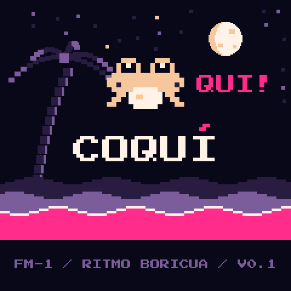
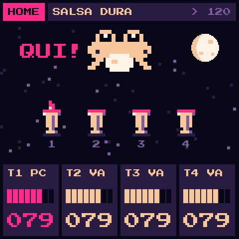
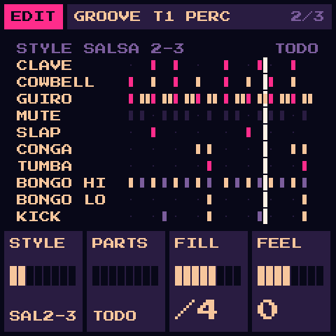
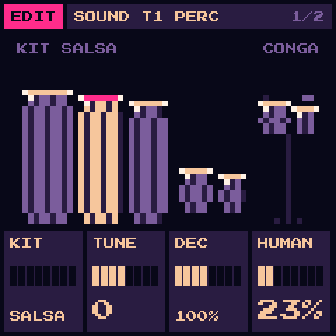
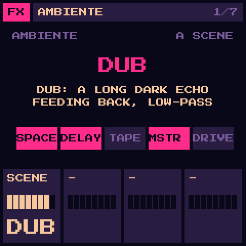
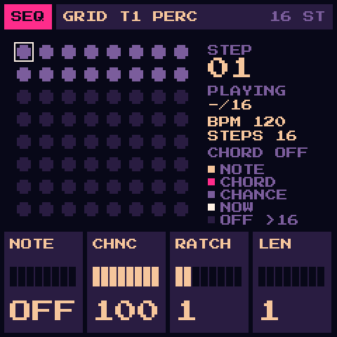

# COQUÍ

**A Latin and Caribbean groovebox firmware for the M-VAVE FM-1.** Salsa, bomba, plena, perreo, merengue, cumbia:
congas, bongos, timbales, güiro, clave and cowbell, all synthesized on the FM-1, played by hand or by the sequencer,
with a HUMAN knob that loosens the hand.

> **Status: 0.1, in development.** Not yet tested on a real FM-1 and not yet on the
> [FM-1 Firmware Hub](https://thefirmwarehub.com). Install at your own risk.



**[The COQUÍ hub](https://saulofilho.github.io/coqui-fm1/)**: hear every style, play the kit, install · **[Try it in your browser](https://saulofilho.github.io/coqui-fm1/emu/)** (the real firmware, no FM-1 needed)

Free and open source (GPL-3.0). Unofficial firmware, not made or endorsed by M-VAVE.
Based on [GR!MM](https://github.com/GRiMMBIENT/grimm) 2.0.2 (see [Credits](#credits)).

## What's inside

- **PERC**, a new sound source: 22 Latin and Caribbean percussion instruments, synthesized (no samples), on the 27 keys
  - kit: kick, snare, clap, rim, closed and open hat, maracas
  - salsa: cowbell and bell, clave, wood block, güiro (short and long), cáscara, paila
  - hand drums: tumba, conga (open, mute, slap), quinto, bongos (low, high, slap), timbales, tambora, an 808-style boom
- **Four kits**: SALSA, PERREO (a long low kick, a tight snare), BOMBA (deeper, longer barriles), TIPICO (tighter, higher)
- **Knobs**: KIT, TUNE (±12 semitones), DECAY (x0.25 .. x4), HUMAN (each hit a little later, softer and off-pitch,
  at random)
- **GROOVE**: a PERC track plays a whole style by itself while the sequencer runs: DEMBOW, PERREO, SALSA 2-3, SALSA 3-2,
  SON, MAMBO, CHACHA, BOMBA SICA, BOMBA YUBA (6/8), PLENA, MERENGUE, BACHATA, CUMBIA, SOCA; with PARTS (the kit, the
  hands, the bells: split a style over two tracks), FILL (every 2, 4 or 8 bars) and FEEL (swing)
- **The lines**: the ARP plays a TUMBAO bass, a piano MONTUNO, a GUAJEO, MERENGUE and BACHATA bass over the chord
  you hold (even one key), on the groove's bars
- **44 factory sounds** made for it: baby bass, montuno piano, cuatro, tres, mambo brass, boogaloo organ, steel pan…;
  the bass and piano ones bring their line (turn PRESETS to TUMBAO BASS, hold C, press PLAY)
- **10 factory kits**, each with its groove: SALSA DURA, PERREO 2004, BOMBA SICA, PLENA CALLE, MERENGUE, CUMBIA, MAMBO,
  BACHATA, DEMBOW, BARRIL LENTO
- **PERC plays its own hits**: up to 10 at once, never taking the six voices the bass and keys tracks share; a drum
  struck again cuts itself, like a hand on the skin
- From GR!MM: 4 tracks, six more sources (VA, FM, SAMPLE, WHEEL, PHYS, PHASE), a 64-step sequencer per track with
  swing, chance and ratchets, song mode, arpeggiator, one-key chords, GENERATE, tape, grain, delay and reverb, MIDI in
  and out, MIDI clock, autosave
- **The mood**: GENERATE in the clave (NOCHE, CALLE, FIESTA), AMBIENTE scenes for the effects (SECO, QUINTAL, CALLE,
  PLAYA, NOCHE, DUB, RADIO AM), a HOME screen where the coquí sings over a conga a track
- A **noche tropical** palette (ROSA, MANGO, MAR, LIMA) and a boot screen with the coquí singing

## The keys on a PERC track

At the default octave (OCT- and OCT+ fold back to the same map):

| | F3 | G3 | A3 | B3 | C4 | D4 | E4 | F4 | G4 | A4 | B4 | C5 | D5 | E5 | F5 | G5 |
|---|---|---|---|---|---|---|---|---|---|---|---|---|---|---|---|---|
| **white** | kick | snare | clap | cáscara | cowbell | clave | güiro | tumba | conga | quinto | bongo lo | bongo hi | timbal lo | timbal hi | boom | tambora |

| | F#3 | G#3 | A#3 | C#4 | D#4 | F#4 | G#4 | A#4 | C#5 | D#5 | F#5 |
|---|---|---|---|---|---|---|---|---|---|---|---|
| **black** | hat | open hat | maracas | bell | wood | slap | mute | güiro long | bongo slap | paila | rim |

MIDI: notes 53 (F3) to 79 (G5) as above; notes outside fold in by two octaves.

## Screens

| | | |
|---|---|---|
|  |  |  |
|  |  |  |

## Install

COQUÍ is not on the Firmware Hub yet. To install a build by hand (Python 3, `pip install mido python-rtmidi`):

```
python3 tools/fm1_install.py build/coqui.fwsc
```

Or use any FM-1 web installer that takes a `.fwsc` file, in Chrome or Edge. COQUÍ keeps its own saves: it does not
read GR!MM's or any other firmware's. If anything goes wrong, the Hub's **Rescue** page brings a stuck FM-1 back
(hold **OCT-** while switching on for the USB rescue).

## Learn it

- [MANUAL.md](MANUAL.md): PERC, GROOVE, and what COQUÍ changes from GR!MM.
- [PLAN.md](PLAN.md): how COQUÍ was made and what is left, in Portuguese.

## The hub page

`hub/` is the [hub](https://saulofilho.github.io/coqui-fm1/) (GitHub Pages, `.github/workflows/pages.yml`). Its sounds and
data come from the firmware itself: after a change to PERC or GROOVE, `tests/run_host.sh` then
`python3 tools/gen_hub.py` (needs ffmpeg, or `pip install imageio-ffmpeg`) makes `hub/audio/` and `hub/coqui-data.js`
again. The web emulator (`hub/emu/`) is the firmware itself compiled to WebAssembly: `APP_VER=0.1 web/build_web.sh`
(the [Emscripten SDK](https://emscripten.org) in `~/emsdk`) before `gen_hub.py`, which copies it in;
`node web/test_web.mjs --emulator` (Node 22 or newer: the SDK's own, `~/emsdk/node/*/bin/node`) checks it against
host mode, sample for sample and pixel for pixel. To look at it all: `cd hub && python3 -m http.server`.

## Building

See [docs/BUILDING.md](docs/BUILDING.md). In short, on Linux x86-64 with the JieLi toolchain and SDK:

```
./build.sh                    # -> build/coqui.fwsc (identity FM-1_923)
tests/run_host.sh             # the host tests, PERC's included
```

## Credits

COQUÍ stands on other people's open work; details and licence texts in [LICENSING.md](LICENSING.md).

- **[GR!MM](https://github.com/GRiMMBIENT/grimm)** by GR!MM (GPL-3.0): the firmware COQUÍ is built from: the tracks,
  sequencer, effects, saves, editor and screens
- **[Felucca](https://github.com/hugelton/Felucca)** by Leo Kuroshita / Hügelton Instruments (GPL-3.0): the platform
  and the VA, FM, WHEEL, PHYS and PHASE engines
- **[Dinghy](https://github.com/zvenson/dinghy)** by zvenson and **[SLOOP](https://github.com/isod89/sloop-fm1)** by
  isod89 (GPL-3.0): the firmware template and the FM-1 platform work
- **msfa** (Apache-2.0), **DaisySP** and **Mutable Instruments Rings** (MIT), via Felucca
- **Press Start 2P** and **Terminus** fonts (SIL OFL 1.1)

## Em português

COQUÍ é um firmware de groovebox com ritmos latinos e caribenhos (salsa, bomba, plena, perreo, merengue, cumbia) para
o M-VAVE FM-1: congas, bongôs, timbales, güiro, clave e cowbell sintetizados, com o knob HUMAN para dar balanço. O plano
do projeto está em [PLAN.md](PLAN.md).

## Licence

GPL-3.0-only. See [LICENSE](LICENSE) and [LICENSING.md](LICENSING.md).
